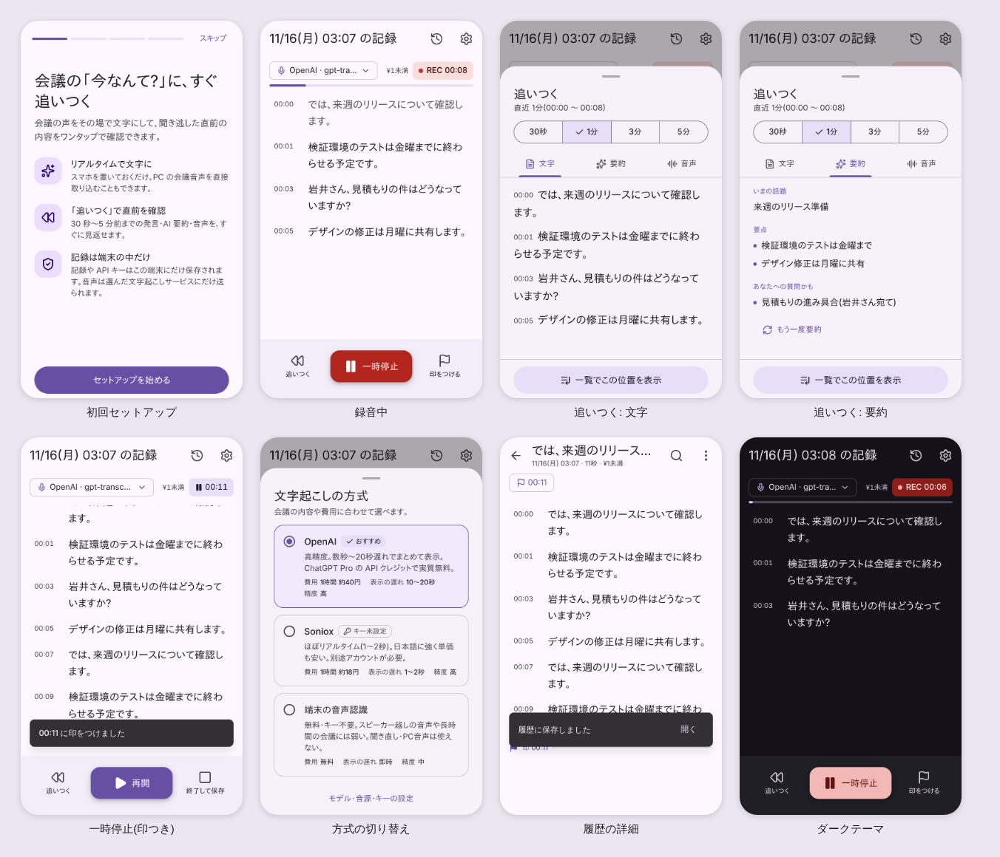

# 会議メモ — リアルタイム文字起こし

会議中に **「今なんて言った?」「さっきの話は何だった?」** にすぐ追いつくための Web アプリ(PWA)です。iPhone でも PC でも使えます。



- **録音画面**: 発言が下に流れ、最新の数行が一番目立ちます。録音状態・経過時間・入力音量・費用は常に上部に表示されます。
- **追いつく**: 下部のボタンから開くシートで、直近 30秒/1分/3分/5分 の範囲を選び、「**文字 / 要約 / 音声**」を切り替えて確認できます。「一覧でこの位置を表示」で本体の該当位置にも飛べます。
- **印をつける**: 「ここ大事」を 1 タップで記録し、あとで履歴から飛べます。
- **一時停止 → 終了して保存**: 会議 1 回が履歴の 1 件になります。履歴では検索・書き出し・名前の変更・削除(元に戻せる)ができます。
- **文字起こしの方式**: OpenAI(gpt-transcribe・おすすめ)/ Soniox(ほぼ即時)/ 端末の音声認識(無料)から選べます。
- **初回セットアップ**: 使い方 → 方式 → API キー → マイクテストの 4 ステップです。
- **ラボ**(設定の一番下): 同じ録音を複数の方式で文字起こしし、CER・速度・費用を比較できます。

画面設計の考え方(Material Design 3 をもとにした情報設計・操作・デザイントークン)は **[docs/DESIGN.md](docs/DESIGN.md)** にまとめています。

方式ごとの費用と品質の比較、推奨する使い分けは **[docs/EVALUATION.md](docs/EVALUATION.md)** にまとめています。

**精度を上げるコツ**(PC のスピーカーから流れる会議を録る場合など)と、既存研究にもとづく改善の内容は **[docs/ACCURACY.md](docs/ACCURACY.md)** にまとめています。一番効くのは、PC のブラウザで開いて音源を「**PCの音声を直接**」にすることです。

## 2つの版
| | Web版(PWA) | ネイティブ版(iOSアプリ, `ios/`) |
|---|---|---|
| 方式 | 内蔵認識 / OpenAI / Soniox | OpenAI / Soniox |
| **画面を消す・他のアプリに切り替える** | ✗ 録音が止まることがある | ✅ **録音を継続**(バックグラウンド音声) |
| 通話などで中断されたとき | ― | 終わったら自動で再開 |
| Soniox の通信が切れたとき | 停止 | 自動で再接続 |
| インストール | URL を開くだけ | Mac + Xcode が必要 |

## Web版の公開(パスワード保護)
公開されるのは **`dist/` に入った暗号化済みのページだけ**です。
- アプリ本体(HTML/CSS/JS)は AES-256-GCM で暗号化されています。パスワード(PBKDF2-SHA256・60万回)を知っている人だけが復号して開けます。
- 誤ったパスワードでは何も表示されません。「この端末を記憶する」にチェックを入れると、次回からパスワードは不要です。設定画面からログアウトもできます。
- **文字起こしの内容・音声・APIキーは、サーバーにもリポジトリにも置かれません**。各端末の中にだけ保存され、音声は選んだ API(OpenAI / Soniox)へ直接送られます。
- 検索エンジンには登録されないように設定しています(noindex / robots.txt)。

### 公開手順(GitHub Pages)
1. リポジトリの Settings → Pages → Source を「**GitHub Actions**」にします。
2. Settings → General → Default branch を `main` にします(Pages のデプロイは既定ブランチからのみ許可されるため)。
3. Actions → 「Deploy web app (password protected)」→ Run workflow を実行します。`main` への push でも自動でデプロイされます。
4. 表示された URL(`https://<ユーザー名>.github.io/v2t_app/`)を iPhone の Safari で開き、パスワードを入力します。「共有 → ホーム画面に追加」でアプリのように使えます。

※非公開リポジトリで Pages を使うには、GitHub Pro 以上のプランが必要です。無料プランの場合は、リポジトリを公開にするか(公開されるのはソースコードだけで、記録やキーは含まれません)、`dist/` フォルダを Cloudflare Pages にアップロードしてください。

### パスワードの変更・人の追加
- Settings → Secrets and variables → Actions に `APP_PASSWORDS` を登録します(12文字以上、カンマ区切りで複数可。例: `自分用パスワード,Aさん用パスワード`)。登録すると、デプロイのたびにそのパスワードで暗号化し直します。
- ある人を外すときは、その人のパスワードを消して再デプロイします。中身の暗号鍵も毎回作り直すので、その人が「記憶した端末」も開けなくなります。
- 手元でビルドする場合は `APP_PASSWORDS="..." npm run build` を実行します。

## ネイティブ版(iOS アプリ)のインストール
詳しい手順・動作確認チェックリスト・困ったときの対処は **[docs/NATIVE_APP_GUIDE.md](docs/NATIVE_APP_GUIDE.md)** にあります。以下は要約です。Mac が必要です(Windows では iOS アプリをビルドできません)。
1. Mac に Xcode(無料)と XcodeGen をインストールします: `brew install xcodegen`
2. `cd ios && xcodegen generate && open V2T.xcodeproj`
3. Xcode → Settings → Accounts で Apple ID を追加します。ターゲット V2T → Signing & Capabilities → Team で自分を選び、Bundle Identifier を一意の名前(例: `com.あなたの名前.v2t`)に変えます。
4. iPhone をケーブルで接続して ▶ を押します。初回は iPhone の「設定 → 一般 → VPNとデバイス管理」で開発元を信頼してください。
   - 無料の Apple ID で入れたアプリは **7日で起動できなくなります**(再度 ▶ でまた使えます)。ずっと使うなら、Apple Developer Program(年 $99)に登録すると TestFlight で配布できます。
5. ⚙ 設定に OpenAI / Soniox の API キーを入れます。キーは Keychain に、記録はアプリ内に保存されます。

## 開発
React 19 + TypeScript + Vite + Tailwind CSS v4 + **shadcn/ui**(Radix UI)で作っています。shadcn/ui のコンポーネントは `src/components/ui/` にあり、Material Design 3 に合わせて調整しています(角丸・状態レイヤー・48px のタッチ領域など)。

```sh
npm install
npm run dev          # 開発サーバー(http://localhost:5173)
npm run typecheck    # 型チェック
npm test             # 単体テスト(音声処理・エンジン・設定/記録の移行など)
npm run build:app    # build/index.html(1 枚にまとめた HTML)を出力
npm run e2e          # Playwright で疑似マイク+API モックの E2E テスト(build:app の後)
APP_PASSWORDS=... npm run build && TEST_PASSWORD=... npm run e2e:dist   # 公開用の暗号化ビルドとそのテスト
```

| 場所 | 役割 |
|---|---|
| `src/screens/` | 画面(録音 / 履歴 / 設定 / ラボ / 初回セットアップ) |
| `src/components/` | 追いつくシート・書き起こし一覧・方式の選択・音量メーターなど |
| `src/components/ui/` | shadcn/ui のコンポーネント(M3 向けに調整) |
| `src/store/` | 状態管理(zustand): 設定・記録・録音の制御 |
| `src/lib/audio.ts` | マイク / PC 音声の取り込み、適応 VAD、音量の正規化、区切り、リングバッファ |
| `src/lib/engines/` | OpenAI / Soniox / 端末の音声認識 |
| `scripts/build.mjs`, `scripts/gate.html` | 公開用の暗号化ビルドとパスワード画面 |
| `ios/` | ネイティブ版(SwiftUI) |

### ブラウザから OpenAI API に直接つながらない場合
社内ネットワークなどでつながらない場合は、Cloudflare Workers などで簡単なプロキシを立て、設定の「API Base URL」にそのアドレスを入れてください。
